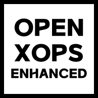

## 정보

**정상혁(Sanghyeok Jeong / チョン・サンヒョク)**

-   📍 대한민국 경기도 일산
    
-   🏫 고려대학교 사범대학 지리교육과 (2021.03 - 2027.02)
    
-   🏫 고려대학교 정보대학 인공지능융합전공 (2025.09 - 2027.02)
    
-   🔎 관심 분야: GIS(지리 정보 시스템), 게임 개발, 생산성
    

* * *

## 프로젝트

### 도구

AI를 활용한 창작 작업과 공간 분석에 편리하게 활용할 수 있는 간단한 도구들입니다.

-   [Markdoc](https://github.com/kveloper/markdoc): 마크다운 문서를 작성하고 문서화할 수 있는 에디터입니다.
    
-   [Codenote](https://github.com/kveloper/codenote): 파이썬, R 코드를 작성하고 가상환경을 생성하여 편리하게 실행시킬 수 있는 가벼운 통합 개발 환경입니다.
    
-   [Commander Panel](https://github.com/kveloper/cp): 파일 정리와 검색을 돕는 강력한 기능의 파일 관리자입니다.
    
-   [KGIS](https://github.com/kveloper/kgis): 편리하고 빠르게 공간 분석을 수행할 수 있는 GIS 소프트웨어입니다.
    
-   [Master Terminal](https://github.com/kveloper/mt): 지능형 에이전트와 Matrix 기반 소통을 텍스트 기반으로 수행할 수 있는 텍스트 기반 어플리케이션입니다.
    

* * *

### OpenXOPS Enhanced

고전 FPS 엑스 오퍼레이션(X Operations)과의 높은 호환성을 목표로 하는 오픈 소스 FPS 게임 및 소스코드 OpenXOPS의 OpenGL 기반 개선 버전입니다.

-   [OpenXOPS 공식 홈페이지](https://openxops.net/en/)
    
-   [OpenXOPS Enhanced GitHub 저장소](https://github.com/kveloper/openxops-enhanced)